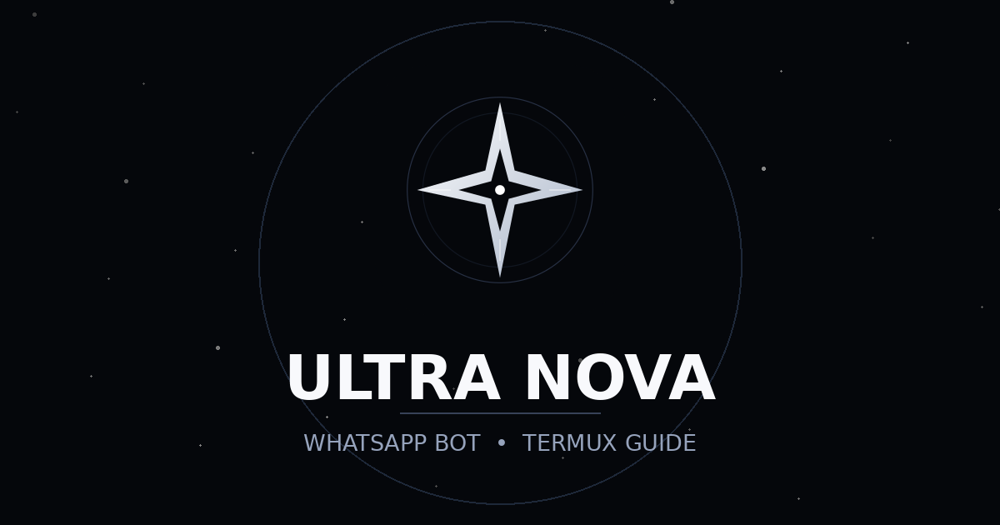

<div align="center">

# Ultra Nova

**Arabic setup guide and command reference for the Ultra Nova WhatsApp bot.**

[](https://aetherdz.github.io/ultra-nova/)
[](index.html)
[](https://aetherdz.github.io/ultra-nova/)


</div>

## Overview

A single-page, mobile-first website (RTL Arabic) that takes a user from downloading the Ultra Nova WhatsApp bot to running it on their phone with Termux. The site itself is static: one `index.html` file with no build step, no framework, and no server-side code.

**Live site:** https://aetherdz.github.io/ultra-nova/

## Preview

| Animation | Link preview card |
| --- | --- |
|  |  |

## Features

- **Step-by-step setup guide** — 8 copy-to-clipboard steps: install Termux, download the bot, extract it, run `node .`, pair with WhatsApp, and start with `.start`.
- **Interactive command reference** — searchable list of every bot command with instant copy on click.
- **Troubleshooting section** — expandable answers for the most common errors.
- **Dark / light theme** — follows the system preference, with a manual toggle saved in `localStorage`.
- **Mobile-first RTL layout** — safe-area aware, responsive, and keyboard accessible.
- **Social preview** — Open Graph and Twitter card tags so shared links show a branded preview image.

## Command overview

Every command is prefixed with a dot (for example `.اوامر`). The full interactive list lives on the site under the **Commands** tab.

| Group | Commands |
| --- | --- |
| General | `.اوامر` `.حالة` `.تست` `.اعدادات` `.نخبة` |
| Group management | `.ادمن` `.خفض` `.طير` `.شات` `.منشن` `.jid` `.مسح` |
| Protection & monitoring | `.حماية` `.قروب` `.فحص` `.طلبات` `.راقب` `.مراقب` `.رابط` |
| Games | `.اكس` |

Elite-only commands are marked 🔰 on the site; locked commands are marked 🔒.

## Repository structure

```text
ultra-nova/
├── index.html                     # The complete site (HTML + CSS + JS)
├── README.md
└── assets/
    ├── ultra-nova-logo.svg        # Vector logo (favicon + README)
    ├── ultra-nova-preview.png     # 1200×630 Open Graph preview image
    └── ultra-nova.gif             # 640×360 animated preview
```

## Run locally

No build required. Either open `index.html` directly in a browser, or serve the folder:

```sh
python3 -m http.server 8000
```

Then visit <http://localhost:8000>.

## Deploy (GitHub Pages)

The repository already has Pages enabled. To re-deploy or change settings:

1. Open **Settings → Pages**.
2. Under **Build and deployment**, choose **Deploy from a branch**.
3. Select branch `main`, folder `/ (root)`, and save.

Every push to `main` rebuilds the site automatically.

## Links

- **Telegram channel:** https://t.me/ultra_nova_v2
- **Bot download:** https://t.me/ultra_nova_v2/11
- **Termux (F-Droid):** https://f-droid.org/packages/com.termux/

## Tags

`#WhatsAppBot` `#Termux` `#UltraNova` `#WhatsApp` `#NodeJS` `#BotTutorial` `#Arabic` `#RTL` `#GitHubPages` `#StaticSite` `#OpenGraph`
