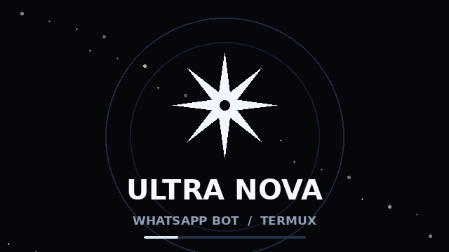

# Ultra Nova

صفحة عربية ثابتة تشرح تثبيت وتشغيل بوت **Ultra Nova** على Termux، وتعرض قائمة أوامر البوت مع البحث والنسخ. الموقع متجاوب مع الجوال، ويدعم الوضعين الفاتح والداكن.

> هذا المستودع يضم صفحة الشرح فقط؛ ملف البوت يُحمّل من [قناة Ultra Nova على تيليجرام](https://t.me/ultra_nova_v2/11).

## معاينة سريعة

افتح `index.html` مباشرة في المتصفح، أو شغّل خادمًا محليًا من مجلد المشروع:

```sh
python3 -m http.server 8000
```

ثم افتح <http://localhost:8000>.

## النشر على GitHub Pages

1. ارفع ملفات المستودع إلى GitHub.
2. من **Settings → Pages** اختر **Deploy from a branch**.
3. حدّد الفرع `main` والمجلد `/ (root)` ثم احفظ.

## الملفات

- `index.html` — الموقع كاملًا (HTML وCSS وJavaScript).
- `assets/ultra-nova-logo.svg` — شعار متجهي للمشروع.
- `assets/ultra-nova.gif` — صورة GIF متحركة مناسبة للمعاينة والمشاركة.

## ملاحظات

- صفحة الموقع الأصلية محفوظة كما أُرسلت؛ لم أغيّر تصميمها أو محتواها.
- الأزرار الخارجية تفتح روابط Termux وTelegram وMT Manager.
- أضف الشعار وGIF من قسم الصور أدناه عند عرض المستودع على GitHub.

## الشعار


## صورة GIF



## وصف المستودع المقترح

`شرح عربي لتشغيل Ultra Nova على Termux، مع قائمة الأوامر وشعار وصورة GIF.`
